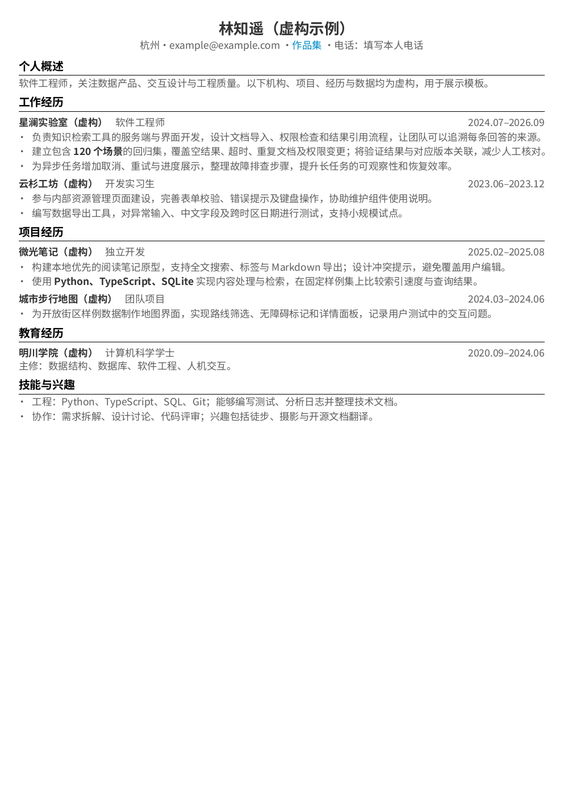

# LaTeX Resume Skill

把简历改稿、项目背景访谈、LaTeX 排版和 PDF 验证交给你的 agent。

这是从实际简历制作流程中整理出的独立小项目：**先核实内容，再组织表达，最后用可编辑的 LaTeX 排版，逐页检查成品**。支持中文和英文，也支持用户提供 PDF / PNG / JPG 作为新模板的版式参考。

仓库只包含虚构示例，**没有作者的真实简历、联系方式、项目经历或历史截图**。自带模板保留我们使用的 A4 单栏、灰色正文、深色重点、黑色分节线和蓝色链接，并提供基于 Tiptap 3.32.0 的可视化编辑器与可搜索的公司、技术及学校图标。图标的集合许可与品牌权利分别说明。



[中文示例 PDF](examples/example-zh.pdf) · [英文示例 PDF](examples/example-en.pdf) · [Skill 入口](skills/latex-resume/SKILL.md) · [完整流程](skills/latex-resume/references/workflow.md)

## 直接复制给 agent

下面整段复制到 Codex、Claude Code 或其他能够读取文件和执行命令的 agent，再发送你的简历即可。无需先手动安装 skill。

```text
请下载 https://github.com/passionworkeer/latex-resume-skill 到一个独立目录（已有时先检查本地修改，避免覆盖）。先阅读 README.md 和 skills/latex-resume/SKILL.md，按文档完成任务。

帮我把接下来提供的简历整理成可编辑 LaTeX 和可投递 PDF。先读取简历，结合我的目标岗位分析内容；可调整表达和结构，但不要编造项目、职责或成果数字。需要更多信息时，针对最影响简历质量的项目背景、本人贡献和验证结果向我提问；已确定的部分继续处理。

缺少 Python、虚拟环境支持、编译器、字体或其他依赖时，请按文档自动检测并安装。优先使用项目内虚拟环境和本地工具；只有环境确实禁止或需要管理员权限时，说明具体阻塞。不要让我手工重复你能完成的安装步骤。

默认先用仓库中的简约单栏模板。如果我发送新的 PDF、PNG 或 JPG 模板，请先观察版式并测量字号、边距、对齐和间距，再用真正可编辑的 LaTeX 重建，不要把整张图当作简历背景，也不要把模板示例人物的经历写进我的简历。

如果我希望自己修改文字，请启动 scripts/preview.py 本地编辑器，用系统默认外部浏览器打开。编辑器默认在输入停顿 650ms 后自动调用 LaTeX 排版；右侧显示真实 PDF 渲染的逐页 PNG，不使用浏览器 HTML 排版。说明如何直接点击文字编辑、选中文字加粗或调字号、点击图标调整大小，以及分别导出 PDF、PNG 和 Markdown。通过带缩略图的模板选择器切换版式，同一份 Markdown 保持不变；首次资源下载可能较慢。需要图标时，使用编辑器的搜索或本地图标目录查找；保留文字名称，核对品牌标识与使用条款，不下载不明来源素材。

把我的资料、证据、改稿和输出放在 private/ 或 output/ 中。不要提交或发布我的真实简历。生成后检查正文是否丢失、页数、文字边界、编译日志，并渲染所有页面逐页检查。交付 PDF、预览、可编辑源码、验证报告和仍需我补充的问题，明确自动检查与视觉检查分别完成了什么。
```

## 本地快速开始

需要 Python 3.10+ 和网络。Python 不存在时，agent 应通过已有的系统包管理器安装；具体平台处理见 [环境说明](skills/latex-resume/references/environment.md)。以下命令从仓库根目录运行：

```bash
git clone https://github.com/passionworkeer/latex-resume-skill.git
cd latex-resume-skill
python3 skills/latex-resume/scripts/setup.py
.venv/bin/python skills/latex-resume/scripts/build.py \
  --source skills/latex-resume/assets/templates/example-zh.md \
  --output output/example-zh
```

Windows PowerShell 将 `python3` 换成 `py -3`，将 `.venv/bin/python` 换成 `.venv/Scripts/python.exe`。安装脚本支持 macOS、Linux 的 ARM64 / x86_64，以及 Windows x86_64 的引擎下载；平台覆盖和实际测试结果分开记录在 [验证记录](docs/VALIDATION.md)。

`setup.py` 自动创建 `.venv/`、安装 Python 包、检查已有 Tectonic / XeLaTeX、必要时下载 Tectonic 到 `.tools/bin/`，并下载、校验和生成字体。无需全局安装字体，无需手工下载 TeX 包。首次字体生成和联网编译可能需要数分钟，后续使用缓存。脚本不修改 shell 配置、不运行远程安装脚本、不自动提权。

构建生成 `resume.pdf`、`resume.tex`、字体副本、正文对照文件、日志、逐页 PNG 和机器验证报告。**脚本通过后，agent 仍须打开所有预览检查重叠、裁切和可读性。** 不能把“编译成功”当作交付完成。

日常使用先把示例复制到 `private/resume.md` 再修改；不要往公开示例中写真实内容。Markdown 子集、编译选项和手工模板入口见 [源码格式](skills/latex-resume/references/source-format.md)。

## 自己修改文字并预览

完成上面的环境安装后，从仓库根目录运行：

```bash
.venv/bin/python skills/latex-resume/scripts/preview.py \
  --workspace private/editor
```

命令会启动仅监听本机的服务，并自动使用**系统默认外部浏览器**打开编辑器。编辑器复用 MIT 许可的 Tiptap 3.32.0；前端已预打包，终端使用者无需安装 Node。先运行 `setup.py` 自动安装 Python 依赖、字体与所需编译器。第一次使用载入虚构中文示例；修改内容后默认停顿 **650ms** 自动保存并调用 LaTeX。编译通常需要数秒，首次下载资源可能更慢；右侧显示实际 PDF 渲染的逐页 PNG，不是浏览器 HTML 排版。

左侧是可直接编辑的简历页面，无需输入 Markdown 语法。选中文字后点击 **B** 或选择字号；全文字号为 **8–18 pt**，选区字号为 **8–32 pt**，均支持 0.5 pt 步进。点击图标后可改 **8–48 pt** 的大小。新增章节、经历条目或要点，使用「＋ 添加内容」；粘贴保留文字，格式用工具栏调整。

「切换模板」展示真实样例缩略图，可在经典单栏、简洁单栏和彩色双栏间切换。左侧提供便于编辑的内容视图，最终布局、分页仍由 LaTeX 决定，以右侧 PDF 预览为准。模板、全文字号与预期页数保存到工作区 `editor-settings.json`；Markdown 原稿保留内容、局部字号和图标大小，不包含上述全局设置。右上角可直接导出 PDF，「更多导出」提供 PNG 和 Markdown。PDF / PNG 只有当前内容和设置通过编译及校验后才启用；继续编辑会立即使旧下载过期并禁用。单页 PNG 直接下载，多页 PNG 打包为 ZIP。

命令行也可以用 `build.py --template classic|minimal|two-column` 选择同一套模板。模板来源、适配范围和许可见 [模板说明](skills/latex-resume/references/templates.md)。

「插入图标」可按名称或 ID 搜索本地 28 个图标，例如 GitHub；点击后在光标所在位置插入 `![logo:github]`。图标仅作装饰，应与文字名称同用，不代表任职、技能或品牌授权。详见 [图标来源与使用边界](skills/latex-resume/references/logos.md)。

已随仓库附带 **28 个公司/技术 SVG 与 15 所学校校徽 SVG**，安装后即可在「插入图标」中搜索，无需单独下载。北京邮电大学可用「北邮」「北京邮电」或 `bupt` 查找；选择后在简历中点击图标，通过「图标大小」调整尺寸。

公开学校素材来自固定版本的 [soulteary/china-university-icon](https://github.com/soulteary/china-university-icon)，保留集合许可、原作者署名、逐文件来源与校验值。集合许可不代表各学校授予商标使用权。未收录学校可由 agent 继续检索、核验并添加；来源不明或明确禁止转载的素材不应混入公开包。旧版下载器仍可用于本地补充，已有本地草稿和素材不会删除。更多来源和使用条件见 [校徽说明](skills/latex-resume/references/logos.md)。

导入已有 Markdown 时，使用新工作区：

```bash
.venv/bin/python skills/latex-resume/scripts/preview.py \
  --source private/resume.md --workspace private/editor-import
```

`--source` 导入为工作区的 `resume.md`，不会直接覆盖原文件。已有不同草稿的工作区会拒绝冲突导入；省略 `--source` 可继续编辑该工作区草稿。「导入」先载入编辑器，随后按默认自动保存与排版流程处理。

草稿在编译前保存；语法错误或编译失败后仍可继续修正。正在保存或连接中断时，请导出 Markdown 保留当前内容。服务退出后重新运行同一工作区可读取已保存草稿和设置；Ctrl+C 停止服务。完整参数、保存和故障处理见 [编辑器说明](skills/latex-resume/references/editor.md)。

维护前端时编辑 `frontend/editor.js`，然后运行 `npm ci`、`npm run build`、`npm test`。源码 ZIP 必须包含 `bundle.js`、`bundle.css`、完整 `licenses/` 与 notices，确保下载后运行无需 Node。设计与选型依据见 [实时编辑器研究](docs/LIVE-EDITOR-RESEARCH.md)和 [Tea 风格设计说明](docs/TEA-DESIGN.md)。

## 安装为 skill（可选）

最简单的方式是让 agent 直接读取仓库内的 `SKILL.md`。如果使用 Codex，也可以把整个 `skills/latex-resume/` 目录复制到 `~/.codex/skills/latex-resume/`，或在可用时使用 skill 安装器指定本仓库和该子路径。已存在同名 skill 时先检查差异，避免覆盖本地修改。

只复制 `SKILL.md` 不够：脚本、模板、下载清单和参考文档都需要一起保留。安装后可以用 `$latex-resume` 调用；首次使用让 agent 选定工作目录，在该目录运行安装位置下的 `scripts/setup.py`，后续构建也从同一个工作目录执行。

## 工作流程

1. **读取和核实**：提取原简历文字，查看原始页面，明确岗位、语言、篇幅和用户优先级。扫描件用 OCR 辅助，并回看图片纠错。
2. **补充项目背景**：围绕问题、个人职责、方案取舍、结果与证据提问。信息不足时保留问题清单；不把团队成果自动归为个人成果。
3. **优化表达**：先给出有依据的改稿，突出问题、行动和结果；数字注明条件与来源，不把本地测试写成线上效果。
4. **选择或复刻版式**：默认使用本仓库模板；新参考图先抽取布局规格，再重建 LaTeX，先比较版式，再填充用户内容。
5. **生成并迭代**：正文和模板分别维护，避免只改生成的 TeX。优先删重复、调结构，再调间距；不靠无限缩小字号挤页。
6. **验证并交付**：检查文字完整性、页数、边界和字体日志；渲染所有页面并逐页查看，交付源码和与本轮文件对应的报告。

详细步骤见 [完整流程](skills/latex-resume/references/workflow.md)、[内容与访谈](skills/latex-resume/references/content-interview.md)、[PDF / 图片模板复刻](skills/latex-resume/references/reference-reconstruction.md)。PDF / 图片参考由 agent 按文档分析和复刻，`build.py` 本身只接收约定的 Markdown 格式。用户可以要求两页或其他风格；单页是自带模板的默认值，不是所有简历的硬性规则。

## 项目结构

```text
skills/latex-resume/
  SKILL.md                 agent 入口
  scripts/                 环境准备、生成、验证和本地编辑器
  assets/templates/        可编辑 LaTeX 和虚构中英文 Markdown
  assets/editor/           本地可视化简历编辑界面
  assets/logos/            品牌 SVG、学校来源目录和许可说明
  references/              工作流程、访谈、模板复刻和环境说明
examples/                  可公开分享的虚构 PDF / PNG
licenses/                  第三方许可证
private/                   用户资料与访谈笔记（Git 忽略）
output/                    用户生成结果（Git 忽略）
```

## 许可与边界

项目原创代码和文档采用 [MIT License](LICENSE)。模板沿用单栏 LaTeX 简历的设计思路，保留 [zheyuye/resume-chinese](https://github.com/zheyuye/resume-chinese) 的 [MIT 署名](licenses/resume-chinese-MIT.txt)。没有复制 CodeCV 网页代码、私有 iconfont、私有品牌素材或个人截图。另行收录的 28 个 SVG 来自固定提交的 [Simple Icons](https://github.com/simple-icons/simple-icons/tree/c71c69e3a27e4436936b831c72643e6513b9f49b)；集合采用 CC0-1.0，个别品牌标识的版权、商标和使用规则仍需分别核对，不能据此声称所有品牌均为 CC0 或已获品牌方授权。见 [图标说明](skills/latex-resume/references/logos.md)。

[Noto Sans SC](https://github.com/google/fonts/tree/main/ofl/notosanssc) 使用 [SIL OFL 1.1](licenses/NotoSansSC-OFL.txt)，由安装脚本从固定提交下载并校验，不归入项目 MIT。Tectonic 从[官方发行版](https://github.com/tectonic-typesetting/tectonic/releases/tag/tectonic%400.17.0)下载；相关引擎、TeX 包和 Python 依赖保留各自许可，见 [第三方说明](THIRD_PARTY_NOTICES.md)。若替换为商业模板、字体或图片，请核对自己的使用和分享权限。

`.gitignore` 只是防止误提交的一层保护。发布自己的 fork 前仍应检查暂存文件、PDF 元数据、截图和 Git 历史。这个 skill 不会替用户证明经历真实性，也不保证招聘系统排名或录用结果。

## English

An agent skill for evidence-based resume editing, project-background interviews, editable LaTeX typesetting, and PDF/image reference reconstruction. Includes fictional Chinese and English examples, three switchable LaTeX layouts with thumbnails, a visual rich-text editor with actual LaTeX PDF/page previews, adjustable text and logo sizes, bundled brand and university SVG marks, a local dependency bootstrapper, content/layout checks, and a required visual review loop. Read [SKILL.md](skills/latex-resume/SKILL.md), run `scripts/setup.py` from your workspace, then build a fictional example before working on private content.
