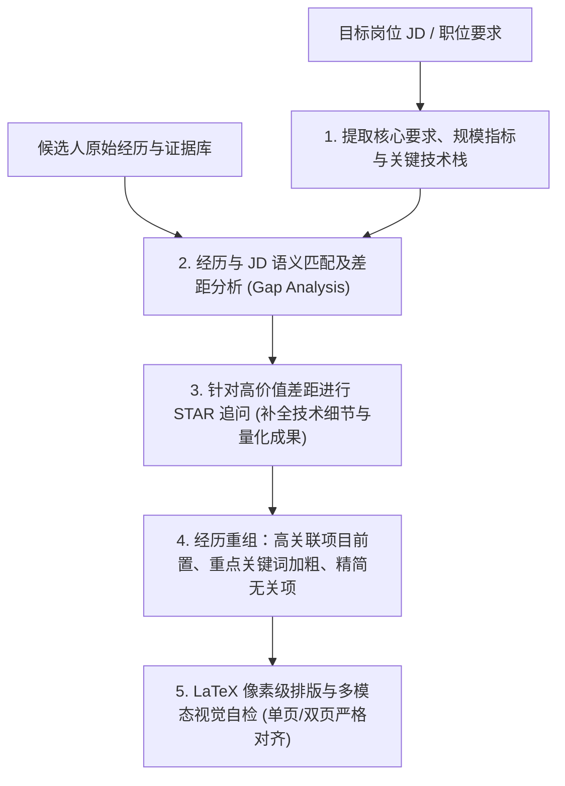

# Target Role Tailoring and ATS Alignment

## First principles: Relevance, Evidence, and Readability

A hiring manager or recruiter spends roughly 6 to 10 seconds scanning a resume. An Applicant Tracking System (ATS) evaluates plain text extraction and semantic keyword coverage. A generic master resume diluted across multiple specialties underperforms a tailored, evidence-backed resume focused on the specific role.

The agent's responsibility is **job description (JD) alignment through genuine evidence, not keyword stuffing or fabrication**.

---

## 1. Deconstruct the target job description

When the user provides a job posting or target role requirements, break it into four buckets:

| Category | Example signals in JD | Agent action |
|---|---|---|
| **Must-Have Core Skills (硬性门槛)** | "熟练掌握 Go/Rust", "深入理解分布式事务与 Raft", "精通 K8s 编排" | Check that every required core technology is explicitly stated in the primary experience or project bullets where the candidate actually used it. |
| **Scale & Metric Constraints (规模与性能要求)** | "亿级 DAU", "海量日志存储 (PB 级)", "高并发高可用 (P99 < 20ms)" | Probe the candidate for the actual data volume, QPS, latency, and hardware constraints in their past projects. |
| **Domain Competencies (业务领域知识)** | "电商结算", "广告召回", "金融级风控", "可观测性 (RUM/APM)" | Highlight domain-specific workflows and terminologies that mirror the target company's business vocabulary. |
| **Preferred / Bonus Qualities (加分项)** | "开源项目活跃贡献者", "有 ACM/ICPC 竞赛经历", "具备底层性能分析与 eBPF 经验" | Pull relevant personal open-source projects, patents, or specialized tools into view. |

---

## 2. Gap analysis: Matching without fabricating

Compare the candidate's existing experience against the decomposed JD requirements:

1. **Direct Matches**: The candidate has production or verified experience matching the JD requirement.
   - *Action*: Promote this bullet higher in the section. Make sure the specific tool/technique is bolded (`**Go**`, `**Raft**`) and the outcome is clearly stated.
2. **Adjacent / Transferable Matches**: The candidate used a related technology (e.g., JD requires Kafka, but candidate used RabbitMQ/RocketMQ; JD requires ClickHouse, but candidate used Doris/StarRocks).
   - *Action*: State the actual technology truthfully, but frame the problem around the shared fundamental architectural concepts (e.g., distributed log compaction, columnar storage compression, partition balancing).
3. **Missing Requirements**: The candidate has no demonstrated background in a key area.
   - *Action*: **Do not invent claims.** Ask the user if they had any unlisted project, prototype, or benchmark touching this area. If not, preserve the integrity of the resume and focus strength on candidate's proven core capabilities.

---

## 3. The STAR + Google XYZ bullet formula

Every technical bullet point should adhere to the Google XYZ standard:

$$\text{Accomplished } [X] \text{ as measured by } [Y], \text{ by doing } [Z]$$

- **X (Outcome)**: What was achieved? (e.g. reduced tail latency, prevented out-of-memory crashes, shortened CI/CD turnaround).
- **Y (Metric & Baseline)**: How was it measured, under what conditions? (e.g. from 180ms to 45ms at 30k peak QPS; cut memory footprint by 40%).
- **Z (Personal Action & Trade-off)**: What did the candidate specifically engineer? (e.g. replaced JSON reflection with zero-copy binary serialization and implemented off-heap buffer pools).

### Bad vs. Good rewrite examples

- ❌ **Vague**: "负责分布式存储系统性能优化，提升了系统吞吐量并获得好评。"
  - *Why it fails*: Passive, vague, lacks personal ownership, lacks technical mechanisms, lacks quantitative conditions.
- ✅ **Strong**: "针对海量时序写入瓶颈，独立设计基于 LSM-Tree 的自适应批量刷盘机制与内存分层索引，在 50 万 QPS 高压写入下将 P99 延迟降低 62%，磁盘 I/O 写入放大比从 14x 降至 3.2x。"

---

## 4. ATS compliance & visual hierarchy

1. **Clean text stream**: The layout generated by `build.py` uses semantic LaTeX macros (`\resumename`, `\resumeheader`, `\entry`, `\item`). PDF extractors parse headings and text in exact logical reading order.
2. **Selective bolding**: Bold key technical terms and quantitative percentages sparingly (1–3 bold marks per bullet). Over-bolding dilutes visual focus; zero bolding makes scanning slow.
3. **Accurate contact links**: Provide clickable URLs for GitHub repositories, technical blogs, and portfolio demos using `[Label](https://...)`.
4. **Header Avatar**: When the target company/market expects a professional headshot, place `![avatar:photo.jpg]` right below the `# Name` line. The layout smoothly reserves a 2.4×3.0 cm top-right slot without text collision. When omitted, the header automatically centers without leaving an empty box.
